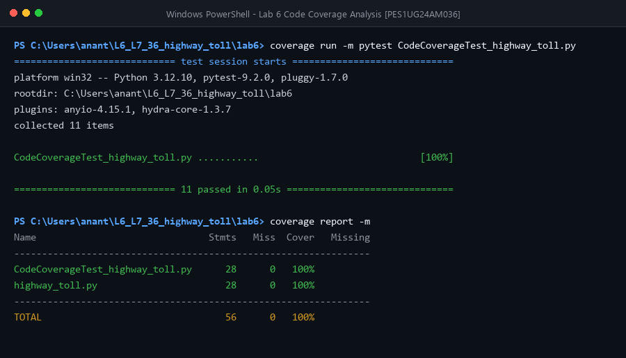
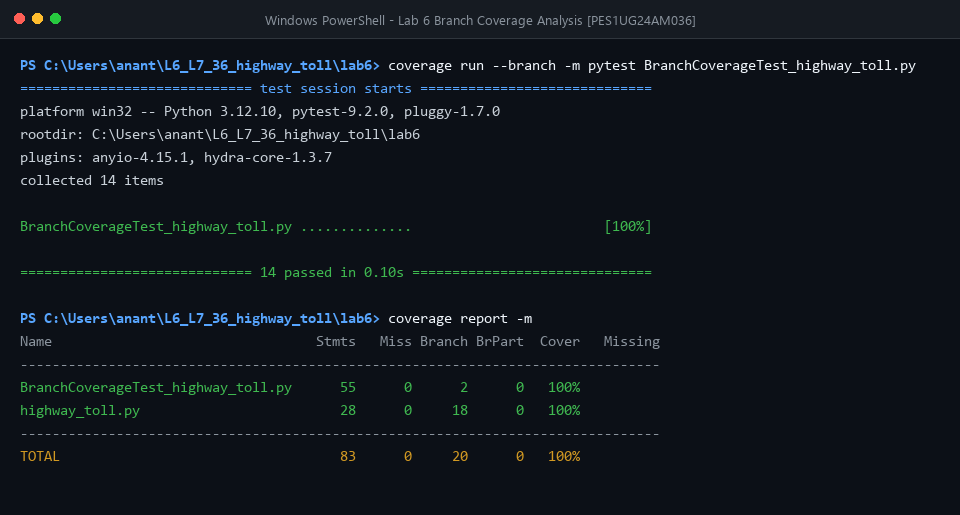

# Lab 6: Code and Branch Coverage Analysis

## Student Details
- **Name:** Ananthakrishna M A
- **SRN:** PES1UG24AM036
- **GitHub:** [anantha-bit](https://github.com/anantha-bit)
- **Repository:** [L6_L7_36_highway_toll](https://github.com/anantha-bit/L6_L7_36_highway_toll)

---

## Objective
- Differentiate between **Line / Statement Coverage** and **Branch Coverage**.
- Use Python's `coverage` and `pytest` libraries to measure, analyze, and maximize test coverage.
- Design comprehensive test cases addressing all edge cases, boundaries, and decision branches.
- Achieve **100% Code Coverage** and **100% Branch Coverage** on the assigned `highway_toll` application.

---

## Application Under Test: `highway_toll.py`
The module calculates highway toll charges based on:
1. **Axle Count:**
   - `< 2`: Raises `ValueError("invalid axle count")`
   - `2` axles: Base toll = 100
   - `3` axles: Base toll = 150
   - `4` axles: Base toll = 250
   - `> 4` axles: Default base toll = 400
2. **Peak Hours:**
   - `is_peak=True`: Adds a 25% surcharge (`base * 1.25`)
3. **Electronic Toll (FASTag):**
   - 2 axles: 10% discount (`base * 0.9`)
   - 3+ axles: 5% discount (`base * 0.95`)
4. **Exempt Vehicles:**
   - `"ambulance"`, `"fire_engine"`: Toll charge is 0
5. **Monthly Pass Advisor (`pass_advice`):**
   - `cost > pass_price`: `"buy_pass"`
   - `cost == pass_price`: `"either"`
   - `cost < pass_price`: `"pay_per_trip"`

---

## Deliverables & File Structure

| File | Description |
|------|-------------|
| `highway_toll.py` | Source application module under test |
| `test_highway_toll.py` | Full test suite combining statement and branch test cases |
| `CodeCoverageTest_highway_toll.py` | Targeted test cases achieving 100% statement/line coverage |
| `CodeCoverageTest_highway_toll_application.py` | Rubric alias (`CodeCoverageTest_xxxx_application.py`) |
| `BranchCoverageTest_highway_toll.py` | Targeted test cases covering every branch decision and condition |
| `BranchCoverageTest_highway_toll_application.py` | Rubric alias (`BranchCoverageTest_xxxx_application.py`) |
| `code_coverage_report.txt` | Raw terminal output for statement coverage |
| `branch_coverage_report.txt` | Raw terminal output for branch coverage |
| `screenshots/code_coverage.png` | Terminal screenshot verifying 100% statement coverage |
| `screenshots/branch_coverage.png` | Terminal screenshot verifying 100% branch coverage |

---

## Coverage Analysis & Results

### 1. Comparison Summary

| Metric | Initial Test Case | Code Coverage Suite | Branch Coverage Suite |
|--------|-------------------|---------------------|-----------------------|
| Statements Covered | 13 / 28 (46%) | 28 / 28 (**100%**) | 28 / 28 (**100%**) |
| Missing Statements | 7, 11, 13, 15-18, 25, 29-36 | None (0) | None (0) |
| Branches Covered | 5 / 18 (39%) | 18 / 18 (**100%**) | 18 / 18 (**100%**) |
| Missing Branches | 5 partial / missing | None (0) | None (0) |

---

### 2. Code Coverage (Statement Coverage)
Command:
```bash
coverage run -m pytest CodeCoverageTest_highway_toll.py
coverage report -m
```

#### Terminal Output:
```
============================= test session starts =============================
platform win32 -- Python 3.12.10, pytest-9.2.0, pluggy-1.7.0
rootdir: C:\Users\anant\L6_L7_36_highway_toll\lab6
plugins: anyio-4.15.1, hydra-core-1.3.7
collected 11 items

CodeCoverageTest_highway_toll.py ...........                             [100%]

============================= 11 passed in 0.05s ==============================

Name                               Stmts   Miss  Cover   Missing
----------------------------------------------------------------
CodeCoverageTest_highway_toll.py      28      0   100%
highway_toll.py                       28      0   100%
----------------------------------------------------------------
TOTAL                                 56      0   100%
```



---

### 3. Branch Coverage
Command:
```bash
coverage run --branch -m pytest BranchCoverageTest_highway_toll.py
coverage report -m
```

#### Terminal Output:
```
============================= test session starts =============================
platform win32 -- Python 3.12.10, pytest-9.2.0, pluggy-1.7.0
rootdir: C:\Users\anant\L6_L7_36_highway_toll\lab6
plugins: anyio-4.15.1, hydra-core-1.3.7
collected 14 items

BranchCoverageTest_highway_toll.py ..............                        [100%]

============================= 14 passed in 0.10s ==============================

Name                                 Stmts   Miss Branch BrPart  Cover   Missing
--------------------------------------------------------------------------------
BranchCoverageTest_highway_toll.py      55      0      2      0   100%
highway_toll.py                         28      0     18      0   100%
--------------------------------------------------------------------------------
TOTAL                                   83      0     20      0   100%
```



---

## Line Coverage vs Branch Coverage: Key Insights

1. **Line Coverage (Statement Coverage):**
   - Measures whether each line of source code was executed at least once during test execution.
   - *Limitation:* 100% line coverage does not ensure every decision path is tested. A single execution passing through a block can mark lines as covered while ignoring alternate logical outcomes (e.g., condition evaluating to `False`).

2. **Branch Coverage:**
   - Measures whether each branch in control structures (`if`, `else`, loops) has been traversed in both `True` and `False` directions.
   - Guarantees that edge cases, boundaries, and alternate pathways (e.g., FASTag discount with `axles == 2` vs `axles != 2`, exempt vs non-exempt vehicles, cost comparison boundaries) are rigorously validated.

---

## How to Run Locally

1. **Install Dependencies:**
   ```bash
   pip install coverage pytest
   ```

2. **Run Code Coverage:**
   ```bash
   cd lab6
   coverage run -m pytest CodeCoverageTest_highway_toll.py
   coverage report -m
   ```

3. **Run Branch Coverage:**
   ```bash
   cd lab6
   coverage run --branch -m pytest BranchCoverageTest_highway_toll.py
   coverage report -m
   ```
