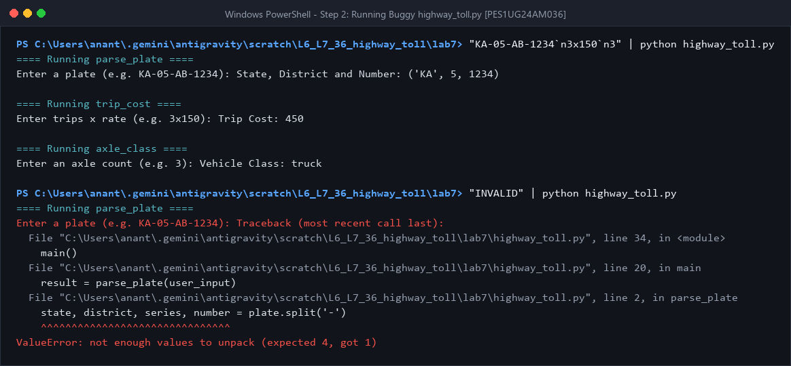
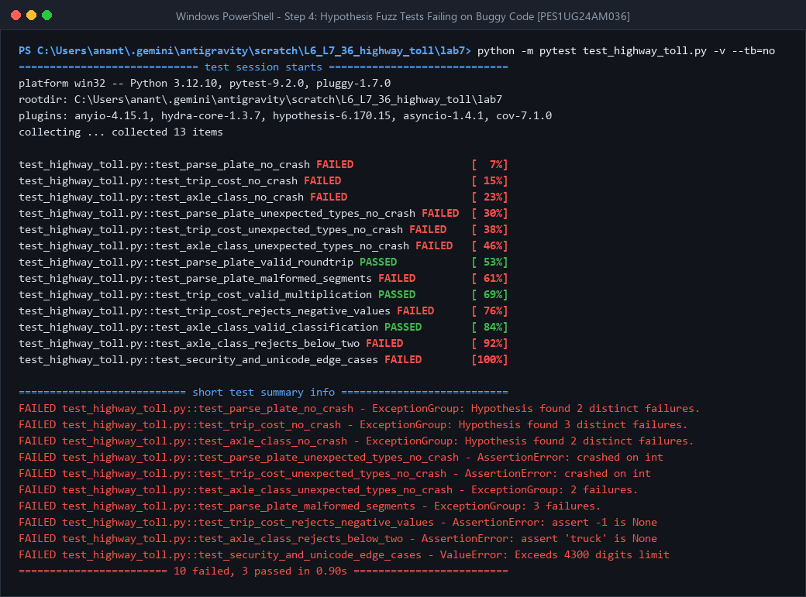
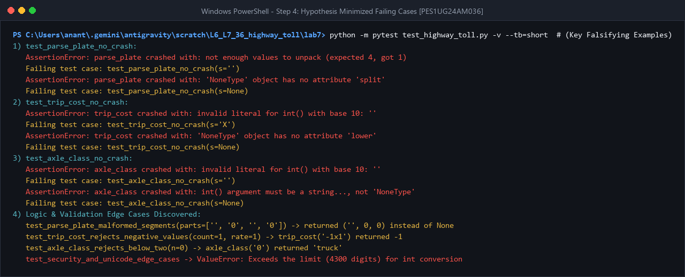
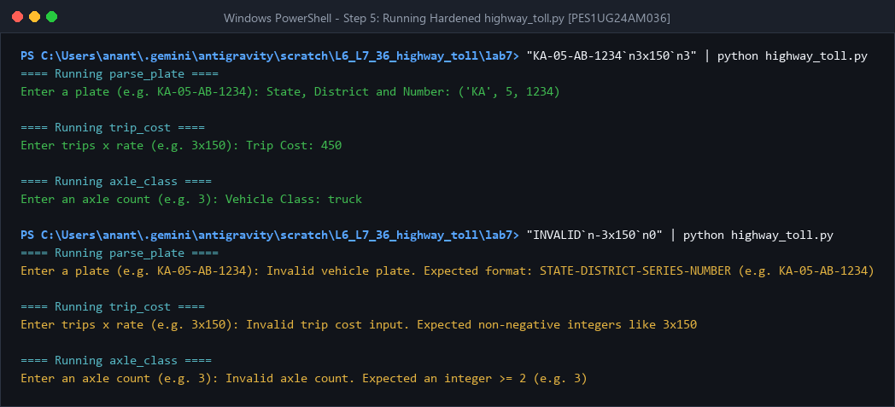
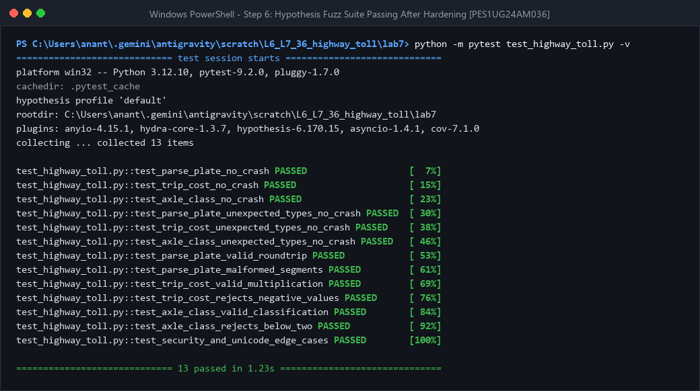

# Lab 7: Fuzzing for Input Validation Bugs

## Student Details
- **Name:** Ananthakrishna M A
- **SRN:** PES1UG24AM036
- **GitHub:** [anantha-bit](https://github.com/anantha-bit)
- **Repository:** [L6_L7_36_highway_toll](https://github.com/anantha-bit/L6_L7_36_highway_toll)

---

## Objective
- Apply **property-based fuzz testing** using Python's `hypothesis` library and `pytest`.
- Uncover crashes, unhandled exceptions, security DoS vectors, and logic validation bugs in `highway_toll.py`.
- Harden all input parsing and validation logic against malformed, negative, non-ASCII, oversized, and unexpected-type inputs.

---

## Application Under Test: `highway_toll.py`
The module provides three highway toll utilities:
1. **`parse_plate(plate)`** — Parses a plate string (`STATE-DISTRICT-SERIES-NUMBER`, e.g., `KA-05-AB-1234`) into `(STATE, district, number)`.
2. **`trip_cost(text)`** — Computes total trip toll from `<count>x<rate>` (e.g., `3x150` → `450`).
3. **`axle_class(axles)`** — Classifies vehicle axles (`2` → `'car'`, `3–4` → `'truck'`, `>= 5` → `'heavy'`).

---

## Deliverables & File Structure

| File | Description |
|------|-------------|
| `highway_toll.py` | Hardened application module with strict input validation |
| `test_highway_toll.py` | Hypothesis property-based fuzzing & edge-case test suite (13 tests) |
| `fuzz_report_before.txt` | Raw pytest + Hypothesis failure output against the original buggy script |
| `fuzz_report_after.txt` | Raw pytest + Hypothesis passing output against the hardened script |
| `screenshots/step2_buggy_app.png` | Execution of original buggy `highway_toll.py` (valid run + crash) |
| `screenshots/step4_fuzz_tests_failing.png` | Pytest summary showing 10 failures on buggy `highway_toll.py` |
| `screenshots/step4_hypothesis_examples.png` | Minimized Hypothesis falsifying examples uncovered |
| `screenshots/step5_fixed_app.png` | Execution of hardened `highway_toll.py` (valid & invalid inputs) |
| `screenshots/step6_fuzz_tests_passing.png` | Pytest verification showing all 13 tests passing after fixes |

---

## Fuzz Testing Results & Bug Analysis

### 1. Initial Run on Buggy `highway_toll.py` (Step 2)


### 2. Hypothesis Fuzz Failures on Buggy Code (Step 4)
Running `python -m pytest test_highway_toll.py -v --tb=no` uncovered **10 failing tests** (with only the 3 happy-path property tests passing):

| Function | Discovered Edge Cases | Buggy Behavior | Hardened Fix |
|----------|-----------------------|----------------|--------------|
| `parse_plate` | `None`, `int`, `""`, `"KA-05"`, `"-0--0"`, `"KA-\u0660\u0665-AB-\u0661\u0662\u0663\u0664"`, `"9"*5000` | `AttributeError` / `ValueError` unpack crashes, empty state accepted `('', 0, 0)`, Unicode digits accepted, or 4300-digit `int()` `ValueError` DoS | Validate `str` type, bounded length (`<= 32`), 4-segment split, ASCII letters for state/series, bounded ASCII digits via `_parse_ascii_uint`, returning `None` on invalid input |
| `trip_cost` | `None`, `""`, `"X"`, `"3x150x2"`, `"-1x1"`, `"\u0663x\u0661\u0665\u0660"`, `"1_0x2_0"` | `AttributeError` / `ValueError` crashes, negative toll cost (`-1`), accepted Unicode digits & underscore literals | Validate `str` type, bounded length (`<= 64`), 2-part split, non-negative bounded ASCII digits only, returning `None` on invalid input |
| `axle_class` | `None`, `""`, `[]`, `True`, `0`, `-5`, `"1"`, `"9"*5000` | `TypeError` / `ValueError` crashes, treated `True` as `1`, returned `'truck'` for negative/0/1 axles, 4300-digit `ValueError` DoS | Reject `bool` and non-int/str types, validate ASCII digits with length cap, reject `< 2` axles by returning `None` |




### 3. Hardened `highway_toll.py` Execution (Step 5)


### 4. Re-Running Fuzz Tests After Hardening (Step 6)
All 13 Hypothesis property tests and regression edge-case checks pass in `1.23s`:



---

## How to Run Locally

1. **Install Dependencies:**
   ```bash
   pip install hypothesis pytest
   ```

2. **Run the Application:**
   ```bash
   cd lab7
   python highway_toll.py
   ```

3. **Run the Fuzz Test Suite:**
   ```bash
   cd lab7
   python -m pytest test_highway_toll.py -v
   ```
